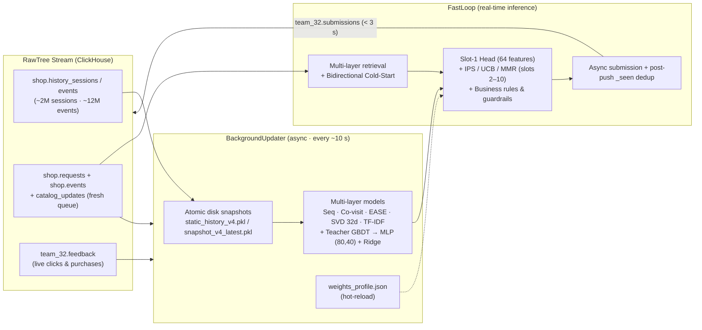

# Datathon FME 2026 · DataVengers (Team 32) — RawTree Challenge

> Real-time recommendation engine for the [**RawTree Real-Time Recommendation Challenge**](datathon-fme-2026-main/README.md) · **Datathon FME 2026** (November 14–15, 2026, UPC Barcelona).

---

## Executive Summary

In an online store with ~5,000 products across 10 categories and 90 subcategories, every incoming request in `shop.requests` requires returning an ordered list of **10 product recommendations** to `team_32.submissions` within **≤ 3,000 ms**, adapting live to price changes (`shop.catalog_updates`), new items (*cold-start*), and real-time user feedback (`team_32.feedback`).

**DataVengers (Team 32)** designed and deployed the **Calypso** family of recommenders, evolving from a lightweight propensity-debiased statistical ranker (`calypso_2_1`) to a modular, hot-reloadable business-rule architecture (`calypso_4_1_e`), and culminating in a Dual-Head hybrid model with *Transfer Learning* (`calypso_6_2_b`) capable of millisecond-scale inference under strict production SLAs.

---

## System Architecture



### Core Engineering Pillars

1. **Production Hardening & SLA Compliance (`< 3,000 ms`)**
   - **Instant startup (`< 0.4 s`)**: atomic disk loading of static history (`static_history_v4.pkl`) and the latest live snapshot (`snapshot_v4_latest.pkl`), avoiding recomputing ~12M historical events on every restart.
   - **`FastLoop` / `BackgroundUpdater` decoupling**: serving queries pull strictly from the recent fresh queue while a background thread incrementally updates live statistics and retrains weights without blocking inference.
   - **Asynchronous submission & post-push deduplication**: writes to `team_32.submissions` never stall subsequent requests, and `request_id` is added to `_seen` only after confirmed delivery.

2. **Multi-Layer Hybrid Retrieval & Bidirectional Cold-Start**
   - Combines first-order sequential transitions (`P(j|i)`), co-visitation, **EASE** item-item similarity, 32-dimensional **SVD**, contextual popularity (`device × region × page`), user affinity, and live trends.
   - **Cold-Start**: bridges newly introduced items without interaction history via TF-IDF + SVD similarity (*forward cold* and *reverse graft* onto active catalog items) alongside category, subcategory, brand, and price compatibility.

3. **Modular Architecture & Business Rules (`weights_profile.json`)**
   - Full decoupling of scoring weights, thresholds, and rules into a hot-reloadable JSON profile managed via `tuner.py`, enabling live tuning without process restarts or dropped requests.
   - Includes 5-segment user profiling, **active / forgotten cart** detection, **repeat-purchase** signals, and click-vs-purchase reward calibration to protect `DCG@10`.

4. **Dual-Head *Slot-1 Precision* & *Transfer Learning* (`calypso_6_2_b`)**
   - **Dedicated Slot-1 Head (`64` features)**: optimized specifically for conversion at carousel position 1 with sequential-overestimation regularization, decoupled from IPS/MMR ranking in slots 2–10.
   - **Teacher → Student Distillation & 2-Phase *Transfer Learning***: `HistGradientBoostingClassifier` distilled into a pure-NumPy **`(80, 40)` MLP**, followed by *Synthetic → Real* hidden-layer Ridge adaptation on `team_32.feedback` and a **Live-CVR Velocity** signal.

---

## Repository Structure

The repository was cleaned via [`.gitignore`](.gitignore) to retain only the official challenge specification and the three milestone versions of the recommender:

| Path | Description |
|---|---|
| [`datathon-fme-2026-main/`](datathon-fme-2026-main/) | Official challenge brief, RawTree schema documentation, starter code, and baseline evaluation notebook. |
| [`calypso_2_1/`](calypso_2_1/) | **Stable Baseline (`calypso-2.1`)**: lightweight 4-stage statistical engine with IPS ranker, UCB bandit, MMR, and SLA disk caching. |
| [`calypso_4_1_e/`](calypso_4_1_e/) | **Modular Milestone (`calypso-4.1e`)**: full weight decoupling in [`weights_profile.json`](calypso_4_1_e/weights_profile.json), hot-reload, [`tuner.py`](calypso_4_1_e/tuner.py), and v4 business rules. |
| [`calypso_6_2_b/`](calypso_6_2_b/) | **Final Production Model (`calypso-6.2b`)**: Dual-Head *Slot-1 Precision*, 64 features, `(80, 40)` MLP distillation + Ridge transfer, Live-CVR Velocity, and FastLoop vectorization. |
| [`README.md`](README.md) · [`.gitignore`](.gitignore) | Project documentation and exclusion rules for intermediate experiments, caches, logs, and local scratch files. |

---

## Model Comparison

| Dimension | `calypso_2_1` (`calypso-2.1`) | `calypso_4_1_e` (`calypso-4.1e`) | `calypso_6_2_b` (`calypso-6.2b`) |
|---|---|---|---|
| **Evolutionary Role** | Stable production baseline | Modular conversion-oriented architecture | Final production model |
| **Scoring Engine** | Linear scorer (14 features) + logistic IPS + UCB bandit + MMR | 5-segment modular scoring + signed-weight IPS | **Dual-Head**: Slot-1 (64 features, `(80, 40)` MLP + Ridge transfer) + IPS/MMR ranking (slots 2–10) |
| **Key Signals** | 1st-order sequences, item CVR, user affinity, contextual popularity, TF-IDF/SVD cold-start | `2.1` base + active/forgotten cart, repeat purchases, price asymmetry, `DCG@10` protection | `4.1.e` base + `EASE`, SVD 32d, `hop2`, co-visitation, `cross_subcat_lift`, multi-channel consensus, Live-CVR Velocity |
| **Configuration & CLI** | `serve.py`, `monitor.py`, `eval.py` | `+` [`weights_profile.json`](calypso_4_1_e/weights_profile.json) & [`tuner.py`](calypso_4_1_e/tuner.py) (hot-reload) | `+` extended [`weights_profile.json`](calypso_6_2_b/weights_profile.json), multi-objective presets & [`tuner.py`](calypso_6_2_b/tuner.py) |

---

## Empirical Results

> Metrics below are grouped strictly by evaluation protocol (5-seed offline ablations, stratified preset benchmark, and live production telemetry) to avoid cross-benchmark distortion.

### 1. 5-Seed Offline Ablations (`calypso_2_1` vs. `calypso_4_1 / 4.1_e`)

5-seed averages recorded in [`ablation_results.csv`](calypso_4_1_e/etapa_4/ablation_results.csv) and [`ablation_v4_results.csv`](calypso_4_1_e/etapa_4/ablation_v4_results.csv):

| Evaluated Configuration | Source | `hit_buy` | `dcg_buy` | `cold_item` | Key Takeaway |
|---|---|---:|---:|---:|---|
| `A_2.1_equivalente` | `ablation_results.csv` | `77.25%` | `0.4749` | `85.87%` | Strong baseline for the `2.1` family |
| `2.1 + penaliz_fondo` (`3.1b`) | `ablation_results.csv` | `79.04%` | `0.4835` | `85.76%` | Penalizing repeated bottom items lifts both hit and DCG |
| `B_4.1_completo` (`precio_asc=True`) | `ablation_v4_results.csv` | `78.72%` | `0.3941` | `82.45%` | Strict ascending price sorting drops `dcg_buy` by `-18.8%` |
| `4.1 - precio_asc` (`4.1.e conversion_first` base) | `ablation_v4_results.csv` | `78.72%` | `0.4799` | `82.45%` | Preserves `4.1` conversion while recovering `dcg_buy` |

### 2. Stratified Offline Preset Benchmark (`calypso_6_2_b`, 1,200 Sessions)

Comparative evaluation on the 1,200-session stratified benchmark of `calypso_6_2_b` (~`1 ms/req` pure engine scoring latency):

| Preset | Objective | `ALL_hit_buy` | `ALL_dcg_buy` | `WARM_hit_buy` | `COLD_hit_buy` | `COLD_item_hit` | `SNIPS_s1` | Engine Latency |
|---|---:|---:|---:|---:|---:|---:|---:|---:|
| `calibrated_m3` | `0.7223` | `75.05%` | `0.4485` | `75.23%` | `74.64%` | `80.49%` | `0.2422` | `1.076 ms` |
| `product_profile_focus` | `0.6922` | `70.32%` | `0.4191` | `65.44%` | `81.88%` | `93.90%` | `0.2344` | `0.807 ms` |
| `conversion_first` (active) | `0.6901` | `69.25%` | `0.4282` | `70.03%` | `67.39%` | `69.51%` | `0.2266` | `0.818 ms` |

### 3. Live Production Telemetry (`calypso-6.2b`)

Observed directly on the RawTree live leaderboard panel while serving `calypso-6.2b`:

| Live Model Version | Requests Served | `On-Time` (`≤ 3 s`) | Latency `p50 / p95` | `CTR / CVR` | `EUR / req` |
|---|---:|---:|---:|---:|---:|
| `calypso-6.2b` | `534 (99.4%)` | `96.82%` | `1199 / 2274 ms` | `3.37% / 1.12%` | `0.2976 €` |

---

## Setup & Usage

### Prerequisites

1. Python 3.10+ with the dependencies listed in `etapa_4/requirements.txt` for the chosen model.
2. Configure RawTree credentials in a `.env` file based on [`datathon-fme-2026-main/.env.example`](datathon-fme-2026-main/.env.example) before running against the live stream.

### Key Commands

```powershell
# Local integrity check (self-check)
python calypso_6_2_b/serve.py --self-check
python calypso_4_1_e/serve.py --self-check
python calypso_2_1/serve.py --self-check

# Local dry-run & preset inspection/evaluation
python calypso_6_2_b/serve.py --dry-run
python calypso_6_2_b/tuner.py --eval-presets
python calypso_4_1_e/tuner.py --list-presets

# Live serving with watchdog supervision & monitoring
python calypso_6_2_b/serve.py --watchdog
python calypso_6_2_b/monitor.py
```

---

## Team · DataVengers (Team 32)

Built by **DataVengers (Team 32)** for the **RawTree Challenge** at **Datathon FME 2026** (Facultat de Matemàtiques i Estadística, UPC).
