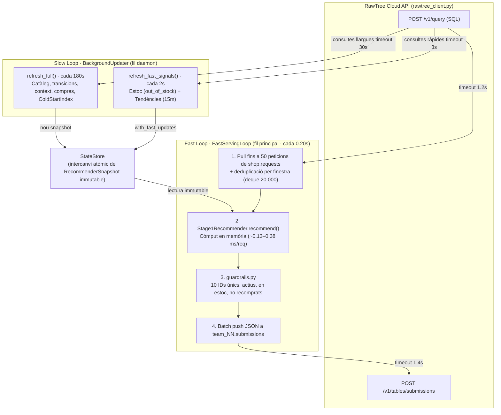

# Funcionament Actual del Sistema (Etapa 1)

Aquest document explica amb detall tècnic **com funciona exactament** el codi implementat fins ara dins la carpeta `etapa_1/`, quin paper juga cada mòdul, com es calcula cada recomanació i com es prova tot plegat abans i després de tenir les credencials de RawTree.

---

## 1. Visió General de l'Arquitectura en Temps Real

El sistema implementat a [serve.py](src/serve.py) executa **dos bucles independents en paral·lel** dins del mateix procés Python, connectats únicament per un contenidor atòmic en memòria (`StateStore` a [state.py](src/state.py)).



### Per què està dissenyat així?
* **Cap consulta pesada bloqueja les respostes:** Si `SQL_TRANSITIONS` triga alguns segons sobre els 12 milions d'esdeveniments històrics, el `FastServingLoop` segueix responent en mil·lisegons amb l'últim `RecommenderSnapshot` vàlid.
* **Immutabilitat (`frozen=True`):** Un `RecommenderSnapshot` no es modifica mai in situ. Quan arriba una actualització ràpida d'estoc (`refresh_fast_signals()`), `with_fast_updates()` construeix un snapshot nou reutilitzant els diccionaris històrics pesats (sense copiar-los) i només recalcula `active_ids` i `global_ranked`.
* **Connexió HTTP reutilitzable ([rawtree_client.py](src/rawtree_client.py)):** `RawTreeClient` manté una `requests.Session` amb `HTTPAdapter(pool_connections=16, pool_maxsize=16, max_retries=0)` per estalviar el *handshake* TLS en cada petició i garantir *timeouts* estrictes (`1.2 s` per lectura en el bucle ràpid, `1.4 s` per enviament).
* **Tolerància a taules buides (`query_safe`):** Quan `shop.requests`, `shop.events` o `shop.catalog_updates` encara són buides, RawTree retorna `Unknown expression identifier`. `query_safe()` captura aquest error esperat i retorna `[]` sense fer caure el servei.
* **Control de memòria (`_seen_queue` + `_seen_set`):** `FastServingLoop` guarda només les últimes `20.000` `request_id` contestades mitjançant un `collections.deque(maxlen=20000)` combinat amb un `set`, evitant que la RAM creixi indefinidament durant tot el cap de setmana.

---

## 2. Quines Dades Carrega i Com Construeix l'Estat (`build_snapshot_from_records`)

Quan s'executa `refresh_full()` (o a l'inici del servei, o en l'avaluador offline), [recommender.py](src/recommender.py) consolida en memòria les següents estructures a partir de les consultes de [serve.py](src/serve.py) i [feature_queries.sql](sql/feature_queries.sql):

1. **Catàleg consolidat (`products`, `active_ids`, `out_of_stock`):**
   * Fusiona `shop.catalog` amb l'últim estat de `shop.catalog_updates` (`_merge_catalog_rows`), preservant el `initial_price_eur` original per poder calcular el descompte relatiu (`ProductInfo.discount_pct` = $\max(0, \frac{p_{\text{inicial}} - p_{\text{actual}}}{p_{\text{inicial}}})$).
   * `active_ids` conté estrictament els productes amb `is_active == True` que **no** són a `out_of_stock`.
2. **Popularitat global i per subcategoria (`product_pop_score`, `global_ranked`, `subcategory_ranked`):**
   * A RawTree es calcula una popularitat ponderada sobre `shop.history_events`:
     $$\text{weighted\_pop} = 5.0 \cdot \text{purchases} + 2.0 \cdot \text{carts} + 0.2 \cdot \text{views}$$
   * Es normalitza a $(0, 1]$ respecte al màxim global i també es genera el top 25 normalitzat dins de cada `subcategory`.
3. **Popularitat contextual (`context_ranked`):**
   * Des de `shop.history_sessions`, agrupa compres reals per `(region, device, page)` (top 30 per context) i construeix un fallback agregat per `("", "", page)`.
4. **Matriu dirigida de transicions en sessió (`transitions`):**
   * A RawTree s'agrupen parells $(A \to B)$ dins de la mateixa `session_id` a `shop.history_events` on $A$ va ser vist (`view`) i $B \neq A$ va tenir activitat:
     $$\text{transition\_score}(A \to B) = 6.0 \cdot \text{co\_purchases} + 2.5 \cdot \text{co\_carts} + 1.0 \cdot \text{co\_views}$$
   * Es conserven els 30 millors destins per producte origen, normalitzats a $(0, 1]$.
5. **Memòria anti-repetició (`user_bought`):**
   * Conjunt `frozenset` dels `product_id` que cada `user_id` ja ha comprat a `shop.history_events`.
6. **Índex de Cold Start (`ColdStartIndex` a [cold_start.py](src/cold_start.py)):**
   * Entrena un `TfidfVectorizer` (unigrames i bigrames, `max_features=4096`, `sublinear_tf=True`) sobre el text concatenat `category + subcategory + brand + description` de tot el catàleg.
   * Per a qualsevol producte marcat `is_new` o amb menys de 3 regles a `transitions`, busca els `max_cold_neighbors = 8` productes càlids (*warm*) més propers combinant:
     $$\text{sim}(q, w) = \cos(\text{TF-IDF}_q, \text{TF-IDF}_w) + 0.35\,\mathbb{I}[\text{subcat}_q = \text{subcat}_w] + 0.15\,\mathbb{I}[\text{cat}_q = \text{cat}_w] + 0.10\,\mathbb{I}[\text{brand}_q = \text{brand}_w] + 0.15\,e^{-|\ln(1+p_q) - \ln(1+p_w)|}$$
7. **Tendències en viu (`live_trends`):**
   * Mesura el *momentum* dels últims 15 minuts a `shop.events` respecte a la mitjana de les 3 hores anteriors.

---

## 3. Com Decideix els 10 Productes (`Stage1Recommender.recommend`)

Per a cada petició entrant (`request`), el mètode `recommend()` de [recommender.py](src/recommender.py) executa els 5 passos següents amb els pesos definits a [config.py](src/config.py):

### Pas 1 · Extracció de context i filtre de compres prèvies
* Extreu `user_id`, `is_new_user`, `context` (`region`, `device`, `page`) i la llista `recent_views`.
* Si `is_new_user` és fals, obté `already_bought = snapshot.user_bought.get(user_id, frozenset())`.

### Pas 2 · Senyals de sessió (`recent_views`, del més recent al més antic)
Per a cada producte vist `v_pid` a l'índex invers `idx = 0, 1, ...` amb pes de decaïment $w = 0.70^{\text{idx}}$:
1. **Re-engagement directe:** Si `v_pid` és actiu i no comprat, suma `0.75 * w` (atenuat a `0.75 * 0.6 * w` quan `idx == 0` i `page == "product"` per deixar espai a productes complementaris al primer slot).
2. **Transicions directes:** Per a cada veí `(dst_pid, t_score)` dins `snapshot.transitions[v_pid]`, suma `1.15 * w * t_score`.
3. **Pont de Cold Start + *Graph Grafting*:** Si `v_pid` és `is_new` o té menys de 3 transicions, consulta `snapshot.cold_neighbors[v_pid]`. Per a cada veí càlid `(nb_pid, sim)`:
   * Suma `0.95 * w * sim` a `nb_pid`.
   * Transfereix (*empelta*) fins a 6 transicions de `nb_pid` sumant `0.70 * w * sim * t_score` als seus productes complementaris.
4. **Afinitat de subcategoria en sessió:** Acumula el pes `w` a la subcategoria de `v_pid`. Les 2 subcategories dominants reben un impuls per als seus 15 millors productes (`0.40 * norm_sw * item_score`). Si l'usuari té perfil històric (`user_subcat_affinity`), també suma `0.35 * u_aff * item_score`.

### Pas 3 · Senyal Contextual
* Busca el rànquing de `(region, device, page)` (o `("", "", page)` com a suport) dins `snapshot.context_ranked` i suma `0.45 * ctx_score` als seus 20 primers productes.

### Pas 4 · Senyals Globals, Tendències i Descomptes
* Garanteix que el top 20 global (`global_ranked`) i el top 15 en tendència (`live_trends`) siguin al conjunt de candidats.
* Elimina de `scores` qualsevol producte que no sigui dins `snapshot.active_ids` o que estigui a `already_bought`.
* Suma als candidats restants:
  $$0.15 \cdot \text{pop\_score} + 0.25 \cdot \text{live\_trend} + 0.20 \cdot \text{discount\_pct}$$

### Pas 5 · Ordenació i Barrera Determinista (`guardrails.py`)
* Ordena tots els candidats per `(-score, -product_pop_score, product_id)`.
* Passa la llista per `ensure_valid_submission()` de [guardrails.py](src/guardrails.py), que:
  1. Filtra duplicats, inactius i `already_bought`.
  2. Completa fins a **10 productes** amb `global_ranked` si en falten.
  3. Només en el cas extrem que l'usuari hagués comprat gairebé tot el catàleg actiu, relaxa `exclude_ids` per evitar retornar menys de 10 ítems.
  4. Abans d'enviar per HTTP, `validate_submission_record()` torna a comprovar `request_id`, longitud `== 10`, `10` IDs únics i pertinença a `active_ids`.

---

## 4. Avaluació Offline i Simulador Sintètic ([eval.py](src/eval.py))

Com que encara no tenim connexió en viu amb RawTree, `eval.py` implementa tant el motor mètric real com un **simulador sintètic** (`generate_synthetic_dataset`) amb el mateix esquema que RawTree (`catalog`, `history_events`, `history_sessions` amb `propensity` i `revenue_eur`, plus 40 `new_product` i compradors nous).

Les mètriques que calcula `evaluate_policy()` i estratifica `evaluate_stratified()` en **`ALL`**, **`WARM`** i **`COLD_START`** són:
* `hit_rate_click@10` i `hit_rate_buy@10`: freqüència amb què el producte clicat o comprat apareix als nostres 10 slots.
* `dcg_buy@10`: ponderació per posició ($1 / \log_2(\text{rank} + 2)$) sobre les compres.
* `IPS` i `SNIPS` a l'Slot 1 per **CTR** (`SNIPS_ctr_slot1`), **CVR de compra** (`SNIPS_cvr_slot1` amb error estàndard `SNIPS_cvr_se`) i **Revenue** (`SNIPS_rev_slot1`), corregint el biaix de popularitat de la política antiga mitjançant $w_t = \frac{\mathbb{I}[a_{t,1} = s_{t,1}]}{\max(p_{t,1}, 10^{-4})}$.
* `latency_ms_mean`: temps mitjà de còmput per petició.

---

## 5. Comandes d'Execució i Verificació

Des de la carpeta arrel del repositori:

```bash
# 1. Passar tots els tests unitaris i d'integració (guardrails, cold start, latència, servei)
python -m unittest discover -s etapa_1/tests -v

# 2. Executar el benchmark offline comparant Baseline vs Stage 1 Hybrid (ALL / WARM / COLD_START)
python etapa_1/src/eval.py

# 3. Provar el bucle ràpid d'enviament en local sense clau API (dry-run sobre 500 peticions)
python etapa_1/src/serve.py --dry-run

# 4. (Quan tingueu TEAM_ID i RAWTREE_API_KEY al .env) Engegar contra RawTree en viu
python etapa_1/src/serve.py
```

### Resum de fitxers a `etapa_1/`

| Fitxer | Funció principal |
|---|---|
| [01_PLANIFICACIO_ETAPA_1.md](01_PLANIFICACIO_ETAPA_1.md) | Especificació tècnica, SLA i arquitectura de l'Etapa 1 |
| [02_PROPOSTES_MILLORA_FUTURES.md](02_PROPOSTES_MILLORA_FUTURES.md) | Full de ruta d'evolucions per Etapes 2 i 3 |
| [03_FUNCIONAMENT_ACTUAL.md](03_FUNCIONAMENT_ACTUAL.md) | Aquesta documentació del codi implementat |
| [eda_queries.sql](sql/eda_queries.sql) / [feature_queries.sql](sql/feature_queries.sql) / [monitoring.sql](sql/monitoring.sql) | Consultes SQL d'anàlisi, extracció i monitorització a RawTree |
| [config.py](src/config.py) | Càrrega de `.env`, *timeouts* i pesos del model |
| [rawtree_client.py](src/rawtree_client.py) | Client HTTP persistent i gestió d'insercions |
| [state.py](src/state.py) | Snapshot immutable i `StateStore` thread-safe |
| [cold_start.py](src/cold_start.py) | Similitud TF-IDF + atributs per a `new_product` |
| [guardrails.py](src/guardrails.py) | Validació estricta de 10 IDs actius i únics |
| [recommender.py](src/recommender.py) | Scorer híbrid `Stage1Recommender` |
| [eval.py](src/eval.py) | Avaluador estratificat i simulador sintètic |
| [serve.py](src/serve.py) | Execució *Fast/Slow Loop* i `--dry-run` |
| [test_stage1.py](tests/test_stage1.py) | Proves unitàries i d'integració |
